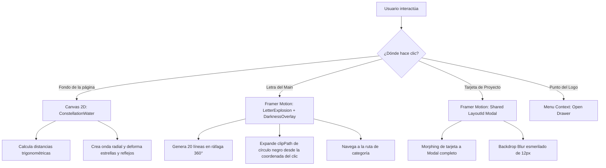

# 🏛️ Análisis Integral de Diseño, Arquitectura y Animaciones
## Portafolio Interactivo - **ALEKXANDER**

Este documento contiene un análisis exhaustivo y detallado de todo el sitio web del portafolio. Se evalúa el concepto visual, la estructura técnica de la interfaz, el sistema de animaciones, la experiencia de usuario (UX/UI) y las oportunidades clave para llevar el diseño al siguiente nivel.

---

## 🎨 1. Dirección de Arte & Concepto Visual

### **Filosofía Visual**
El portafolio se define bajo una estética **mística, cósmica y minimalista dramática**. Combina la oscuridad profunda con destellos de luz brillante, reflejos acuáticos y transiciones espaciales. 

- **Concepto Central**: El nombre **ALEKXANDER** funciona como un acrónimo interactivo donde cada letra es la puerta de entrada a una disciplina/categoría técnica y artística:
  - **A**nimation | **L**ogic | **E**xperience | **K**ode | **X**pression | **A**rt | **N**arrative | **D**esign | **E**dition | **R**esearch.

### **Paleta de Colores y Sombras**
| Elemento | Color / Estilo | Propósito / Efecto |
| :--- | :--- | :--- |
| **Fondo Principal** | `#000000` (Negro Puro) | Absorción total de luz, inmersión dramática. |
| **Texto Principal** | `#FFFFFF` (Blanco Puro) | Alto contraste, legibilidad en títulos e interacciones active. |
| **Texto Secundario** | `#777777` / `gray-300` / `gray-400` | Jerarquía secundaria, categorías inactivas o sin proyectos. |
| **Efectos Glow** | `rgba(255, 255, 255, 0.8)`, `rgba(100, 150, 255, 0.7)` | Resplandor neón/astral al interactuar con elementos activos. |
| **Contenedores Glass**| `bg-black/30 backdrop-blur-sm border-white/10` | Tarjetas con efecto vidrio esmerilado que flotan sobre el canvas. |

### **Tipografía**
- **Encabezados / Marca / Letras**: `font-trajan` (`Trajan Pro` / estilo romano refinado). Otorga un carácter elegante, clásico y majestuoso.
- **Cuerpo de Texto**: Tipografía Sans-Serif de sistema (`-apple-system`, `BlinkMacSystemFont`, `Segoe UI`, `Roboto`), limpia y legible.

---

## 💻 2. Estructura de la Aplicación y Componentes

### **Arquitectura General (`src/`)**
```
src/
├── components/
│   └── ui/
│       ├── ConstellationWater.jsx  # Canvas 2D interactivo (estrellas + agua + reflejos)
│       ├── DarknessOverlay.jsx     # Transición dramática circular entre páginas
│       ├── ExplosionParticles.jsx  # Partículas secundarias
│       ├── LetterExplosion.jsx     # Destello/líneas proyectadas al hacer clic en letra
│       ├── LogoImage.jsx           # Renderizado del logo de marca
│       ├── Menu.jsx                # Panel lateral flotante de navegación
│       └── TestCube.jsx            # Componente de pruebas
├── constants/
│   ├── categories.js               # Mapeo de letras a categorías (ALEKXANDER)
│   └── projects.js                 # Base de datos de proyectos detallados
├── contexts/
│   ├── MenuContext.jsx             # Estado global del menú deslizante
│   └── NavigationContext.jsx       # Coordinador de transiciones dramáticas
├── hooks/
│   └── useDarkNavigation.js        # Lógica de captura de clic y cambio de ruta
└── sections/
    ├── About.jsx                   # Sección "Sobre mí" / CV / Redes
    ├── CategoryView.jsx            # Módulo de proyectos por categoría + Modal
    └── Home.jsx                    # Portada interactiva principal
```

---

## 🎬 3. Desglose Detallado del "Main" (`Home.jsx`)

La pantalla principal es una experiencia interactiva completa dividida en 3 capas de profundidad visual ($Z\text{-Index}$):

### **Capa 1: Canvas de Constelación y Agua (`Z-0`)**
- Renderiza el canvas interactivamente en segundo plano.
- Detecta clics en cualquier punto de la pantalla para generar **ondas expansivas de deformación**.

### **Capa 2: Logo e Disparador de Menú (`Z-10`)**
- Presenta el **Logo Central** semi-transparente (`opacity: 0.15`) que actúa como marca de agua en el centro.
- Contiene un **punto pulsar interactivo** con posición fija relativa (`top: 65.2%`, `left: 65.5%`) animado con un resplandor en pulso (`animate-pulse`). Al ser presionado, despliega el `Menu` lateral.

### **Capa 3: Acrónimo Interactivo "ALEKXANDER" (`Z-20`)**
- Renderiza las 10 letras dispuestas horizontalmente con tipografía Trajan.
- **Lógica de Estado Activo/Inactivo**:
  - Si la categoría asociada posee proyectos cargados (`categoryHasProjects`), la letra brilla en blanco con animación de sombra pulsante (`pulse-glow`) e interactividad completa.
  - Si la categoría aún no posee proyectos, se presenta atenuada en tono grisáceo (`#777777`).
- **Disparador de Animación**:
  1. Al presionar una letra, se capturan las coordenadas `(clientX, clientY)`.
  2. Se instancian las partículas de `LetterExplosion.jsx`.
  3. La letra se oculta (`breakingIndex` -> `opacity: 0`).
  4. Dispara el `DarknessOverlay` para transicionar hacia `/category/:categoryName`.

---

## ⚡ 4. Sistema de Animaciones e Interactividad

El proyecto combina varias tecnologías de animación de forma sinérgica:



### **1. Canvas de Agua y Constelaciones (`ConstellationWater.jsx`)**
- **Estrellas y Red**: Se generan 100 estrellas aleatorias. Se conectan dinámicamente con líneas si la distancia entre dos puntos es menor a `min(150px, width * 0.12)`.
- **Efecto Espejo/Reflejo**: En la mitad inferior del canvas, se duplican las estrellas y líneas con opacidad reducida (`0.5`) y un desplazamiento vertical oscilatorio guiado por una función senoidal:
  $$\text{offset}_y = \sin(x \cdot 0.01 + \text{time} \cdot 2) \cdot 12$$
- **Física de Ondas**: Cada clic añade una onda con radio expansivo (`radius += 5`) y atenuación (`life *= 0.98`). Las estrellas cercanas son empujadas en la dirección del vector respecto al epicentro:
  $$\Delta x = \cos(\theta) \cdot (1 - \frac{\text{dist}}{\text{radius}}) \cdot \text{strength} \cdot \text{life}$$

### **2. Explosión de Letras (`LetterExplosion.jsx`)**
- Dispara 20 rayos finos (`2px`) emitidos radialmente en ángulos aleatorios (`0°` a `360°`).
- Emplea `framer-motion` para animar la traslación $X, Y$, aumentar la escala vertical (`scaleY: 1.5`) y desvanecer la opacidad a cero en $800\text{ms}$.

### **3. Transición Trans-Página (`DarknessOverlay.jsx` / `useDarkNavigation.js`)**
- Utiliza la propiedad CSS `clip-path: circle(r at x y)`.
- Crece desde `circle(0% at x y)` hasta `circle(150% at x y)` cubriendo la pantalla completa de negro antes del cambio de ruta en React Router.
- Otorga una transición dramática cinemática e hiper-fluida.

### **4. Animación Descompresiva de Título (`CategoryView.jsx`)**
- Al ingresar a una categoría, el título aparece inicialmente gigante en el centro de la pantalla (`scale: 2.5`, `top: 50%`, `textShadow: 0 0 100px white`).
- Tras una pausa de $600\text{ms}$, viaja suavemente hasta su posición superior (`top: 2rem`, `scale: 1`), revelando el contenido mediante una máscara de círculo inverso.

---

## 🎯 5. Diagnóstico y Oportunidades de Mejora (Roadmap de Rediseño)

A pesar de que la base visual es deslumbrante y única, existen aspectos de diseño, UI/UX y técnicos que se pueden optimizar sustancialmente:

### 🔴 **1. Tipografía Trajan Pro (Falta de Webfont Explicita)**
- **Problema**: `index.css` especifica `.font-trajan { font-family: 'Trajan Pro', serif; }`, pero la fuente no está cargada vía Google Fonts ni `@font-face`. Si el visitante no tiene Trajan Pro instalada localmente en su sistema operativo, el navegador cargará la fuente Serif genérica (Times New Roman).
- **Recomendación**: Importar en `index.html` una fuente serif cinemática de alta calidad como **Cinzel**, **Cormorant Garamond** o **Cinzel Decorative** desde Google Fonts.

### 🔴 **2. Limpieza de Estilos Residuales en `App.css`**
- **Problema**: El archivo `App.css` incluye cerca de 150 líneas de código CSS heredado de la plantilla por defecto de Vite (`.counter`, `.hero`, `#center`, `#next-steps`, `.ticks`, etc.) que no se utilizan en la aplicación.
- **Recomendación**: Purgar `App.css` para mantener solo los estilos necesarios (`.custom-scroll`) o moverlos directamente a `index.css`.

### 🟡 **3. Responsividad y Descubrimiento del Menú en Móvil**
- **Problema**: En `Home.jsx`, las letras de **ALEKXANDER** están dentro de un contenedor horizontal con `flex-nowrap overflow-x-auto`. En dispositivos móviles estrechos, las letras pueden requerir scroll lateral o apretarse en exceso. Además, el botón disparador del menú (el punto en el logo) se ubica en coordenadas fijas porcentuales (`top: 65.2%`, `left: 65.5%`), lo que dificulta su descubrimiento por parte del usuario.
- **Recomendación**:
  - Incorporar un botón de menú tipo Hamburguesa/Icono evidente en la esquina superior derecha o fija.
  - Asegurar un escalado tipográfico `clamp()` más responsivo para el acrónimo central.

🟡 **4. Feedback Visual en Categorías sin Proyectos**
- **Problema**: Las letras sin proyectos están en gris (`#777777`). Sin embargo, si el usuario hace clic en ellas, la aplicación realiza toda la animación de explosión y transición oscura para llevarlo a una página casi vacía que dice `"Próximamente más proyectos..."`.
- **Recomendación**:
  - Mostrar un micro-tooltip o aviso sutil al pasar el cursor / presionar una categoría inactiva (*"Próximamente"*), o deshabilitar la navegación si no hay proyectos, evitando frustración en la navegación.

### 🟢 **5. Enriquecimiento Visual del Grid de Proyectos (`CategoryView.jsx`)**
- **Problema**: Las tarjetas de proyectos muestran la imagen con un degradado y el título. Para un portafolio de tecnología y videojuegos, se echa en falta información rápida de las tecnologías utilizadas.
- **Recomendación**:
  - Añadir **Badges/Tags de tecnologías** (ej: `React`, `Unity 3D`, `Node.js`, `Prisma`) directamente sobre las tarjetas con estilo glassmorphism.
  - Agregar un indicador de la categoría o duraciones del proyecto.
  - Efectos hover con bordes iluminados por resplandor gradiente.

---

## 🛠️ 6. Resumen Ejecutivo del Análisis

| Dimensión | Puntuación | Aspectos Destacados |
| :--- | :---: | :--- |
| **Concepto & Creatividad** | **9.5 / 10** | Propuesta altamente innovadora con el acrónimo interactivo y estética mística. |
| **Animaciones & Efectos** | **9.5 / 10** | Excelente combinación de Canvas 2D, Framer Motion y transiciones por `clip-path`. |
| **Experiencia de Usuario (UX)** | **7.5 / 10** | El disparador del menú en el logo es poco intuitivo; navegación a categorías vacías genera fricción. |
| **Arquitectura de Código** | **8.5 / 10** | Estructura limpia por contextos y hooks. Oportunidad de purgar CSS sobrante y asegurar fuentes web. |

---
*Documento generado por **Antigravity AI** para el análisis y evolución del diseño de `alekxander-portfolio`.*
